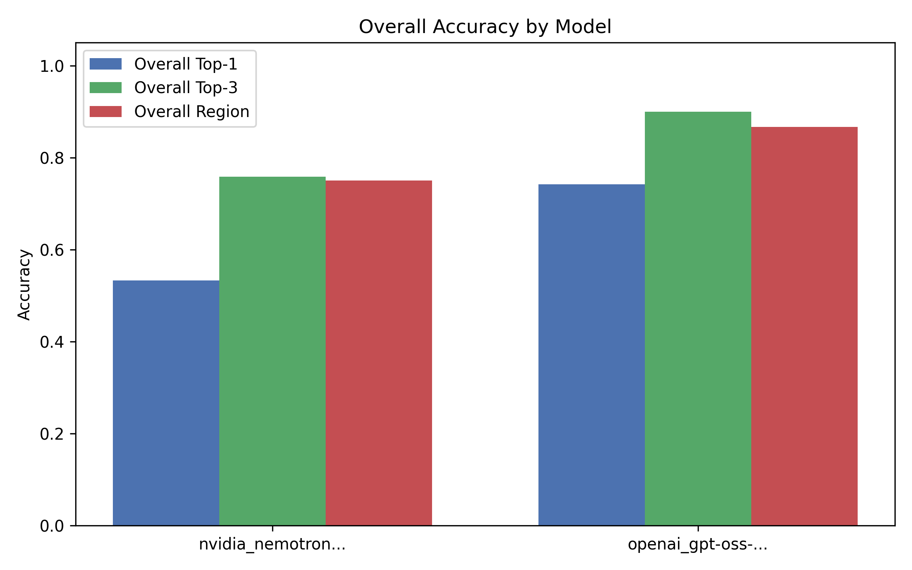

# LLMs for Fault Localization
 

 
Can a language model find the buggy line in a Python function, and does it help to
give it the failing tests or a spectrum-based fault localization (SBFL) ranking?
 
I injected single-line bugs into 30 HumanEval functions with an AST-based mutant
generator, ran each function's pytest suite under coverage, ranked lines with
Tarantula, and asked two LLMs to locate the bug under four conditions
(30 bugs x 4 conditions = 120 prompts per model).
 
## Key result
Tests helped both models; the SBFL ranking hurt. Nemotron's Top-1 accuracy dropped
from 80% (code only) to 27% when given the Tarantula ranking.
For example, in is_prime, Tarantula assigned high suspiciousness to a return True statement simply because it was executed by failing tests, while the actual faulty loop condition was ranked lower. The models blindly chose the highly-ranked return True line, completely failing to analyze the logic. 
 

 
Results by bug type (constant, comparison, arithmetic, boundary ...):
experiment/results/metrics_by_bug_type.json
 
## How it works
1. Mutation: generate_mutants.py changes one AST node per function and keeps
   only mutants that make at least one test fail.
2. Coverage and SBFL: run_sbfl.py runs each test under coverage.py and computes
   Tarantula suspiciousness per line.
3. Prompts: generate_prompts.py builds the four conditions (A-D).
4. LLM evaluation: run_llm_evaluation.py queries OpenRouter, with rate limiting
   and key rotation.
5. Metrics: compute_metrics.py - Top-1, Top-3, region (+-2 lines), MRR,
   invalid-output rate.
 
## Run it
python -m venv venv
venv\Scripts\activate            # Linux/macOS: source venv/bin/activate
pip install -r requirements.txt
python -m pytest                  # 486 tests: HumanEval suites + pipeline tests
 
Pipeline (from the repository root):
python -m experiment.scripts.generate_mutants
python -m experiment.scripts.run_sbfl
python -m experiment.scripts.generate_prompts
python -m experiment.scripts.run_llm_evaluation   # needs .env, see .env.example
python -m experiment.scripts.compute_metrics
python -m experiment.scripts.generate_plots
python -m experiment.scripts.generate_report      # writes experiment/website/
 
## Project structure
experiment/src/                    original HumanEval functions
experiment/tests/humaneval/        pytest suite for each function
experiment/tests/infrastructure/   tests for the pipeline itself
experiment/dataset/                mutants, ground truth, bug types, SBFL data
experiment/scripts/                the pipeline
experiment/results/                prompts, raw LLM responses, metrics
experiment/website/                HTML report and slides
experiment/test_results_report.md  original vs mutant test results
 
Topics in Software Engineering, Tel Aviv University.
